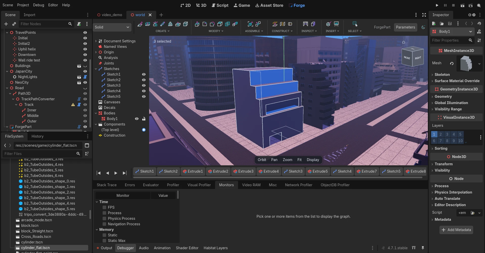

# Holo Forge

Parametric CAD inside the Godot editor. Holo Forge adds a **Forge** tab next to 2D / 3D / Script, where you sketch with constraints and dimensions, model solids and surfaces, sculpt subdivision forms, edit meshes and build jointed assemblies. The parts end up in your game as ordinary baked meshes.



- **CAD kernel:** OpenCASCADE 8.0.1 for solids and surfaces, the planegcs constraint solver for sketches, OpenSubdiv for Form, plus Manifold, pmp and meshoptimizer for meshes. It runs as a C++ GDExtension.
- **Workspaces:** Sketch, Solid, Construct, Inspect, Insert, Surface, Form, Mesh and Assemble.
- **Output:** each body bakes as its own `MeshInstance3D` and each component as its own node, with optional collision and Godot joints. Exports to STEP, IGES, STL, OBJ, 3MF, GLB and `.tscn`.

The kernel runs **in the editor only** (Windows 64-bit, Godot 4.7+). Exported games use the baked meshes, so they never load it and work on every platform Godot supports.

## Repository layout

| Folder | What it holds |
|---|---|
| `addons/holo_forge/` | The plugin: GDScript, shaders, icons, and the prebuilt Windows DLLs in `bin/`. Its own [README](addons/holo_forge/README.md) explains how to use it. |
| `holo_forge_native/` | The C++ source of `holo_forge_native.dll`: `src/`, `CMakeLists.txt`, `vcpkg.json`, the release-only vcpkg triplet, planegcs (from FreeCAD), and godot-cpp 10.0.0-stable as a git submodule. |
| `tests/` | Headless tests (`holo_forge_*_test.gd`), in-editor hooks (`--holo-forge-*-editor-test`) and their fixtures (`tests/holo_forge/`). |
| `docs/` | Status and next steps (`HOLO_FORGE_STATUS_AND_NEXT_STEPS.md`), the phase specs, and screenshots. |

## Install the plugin

The easiest way is the Windows installer from the [latest release](https://github.com/Blazer-Humphreys/HoloForge/releases/latest): run `holo_forge-<version>-windows-setup.exe`, pick your project and your Godot 4.7+ editor, and it copies the addon in, turns the plugin on and runs a self-test.

By hand:

1. Copy `addons/holo_forge` into your Godot project, so you have `<your project>/addons/holo_forge/plugin.cfg`.
2. Open the project, then go to **Project > Project Settings > Plugins** and tick **Holo Forge**.
3. A **Forge** tab appears at the top of the editor.

To check an install, use **Project > Tools > Holo Forge: Run Self-Test** (`addons/holo_forge/self_test.gd`).

Add `~*.dll` to your project's `.gitignore`: while the editor is open, Godot keeps a working copy of the kernel there.

## Build the native library

You need Visual Studio 2022 (MSVC x64), CMake 3.28+, Python 3 and vcpkg.

```bash
git clone --recursive https://github.com/Blazer-Humphreys/HoloForge
```

```bash
cmake -S HoloForge/holo_forge_native -B build -G "Visual Studio 17 2022" -A x64 -DCMAKE_TOOLCHAIN_FILE=<vcpkg>/scripts/buildsystems/vcpkg.cmake -DVCPKG_OVERLAY_TRIPLETS=HoloForge/holo_forge_native/triplets -DVCPKG_TARGET_TRIPLET=x64-windows-release -DVCPKG_HOST_TRIPLET=x64-windows-release -DHOLO_FORGE_ADDON_BIN_DIR=HoloForge/addons/holo_forge/bin
```

```bash
cmake --build build --config Release
```

The first configure builds OpenCASCADE and the other libraries through vcpkg, which takes about an hour. The build copies `holo_forge_native.dll` and every DLL it needs into `HOLO_FORGE_ADDON_BIN_DIR`. `holo_forge_native/build.ps1` does the same with the original author's folders. `package_release.py` makes the release zip, the LGPL source zip and, with Inno Setup 6.3+ installed, the Windows installer (`holo_forge_native/installer/holo_forge_setup.iss`).

## Tests

The tests were written inside a host game project. They expect a 1600×900 window, Jolt Physics, and a few of that project's materials (`materials/ridgeway_stunt_wall.tres` and texture sets under `materials/material_library/`). Copy `tests/` next to `addons/` in such a project, open it in the editor once to import, then run:

```bash
godot --headless --path <project> --script res://tests/holo_forge_document_test.gd
```

```bash
godot --headless --path <project> --editor -- --holo-forge-handles-editor-test
```

Run one `--editor` hook at a time. Each one prints `PASS` or `FAIL` and exits with 0 or 1.

Add `--holo-forge-test-world-offset` after `--` to any test or hook to run it with the Forge view's space moved off its origin (as Passthrough moves it). Everything should pass that way too.

`holo_forge_background_render_test.gd` and `holo_forge_passthrough_render_test.gd` check rendered pixels, so they need a window (no `--headless`). Run each in both renderers, since the Forge view has to draw in Forward+ and in Compatibility projects:

```bash
godot --path <project> --rendering-method forward_plus --script res://tests/holo_forge_background_render_test.gd
```

```bash
godot --path <project> --rendering-method gl_compatibility --script res://tests/holo_forge_background_render_test.gd
```

## Licenses

Holo Forge's own code is under the MIT License (see [LICENSE](LICENSE)) since 2026-11-18; the v0.1.0 and v0.1.1 releases were published under GPL-3.0. You can ship games that contain Holo Forge's scripts (baked parts use `nodes/cad_part.gd`) under any license you like, as long as you keep the MIT notice.

The third-party libraries keep their own licenses (see `addons/holo_forge/THIRD_PARTY_NOTICES.md` and `addons/holo_forge/licenses/`). OpenCASCADE and planegcs are LGPL 2.1 and ship as separate DLLs that you may replace with your own builds. The editor alone uses them, and they are left out of game exports.
